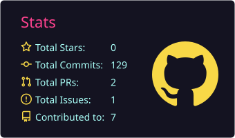
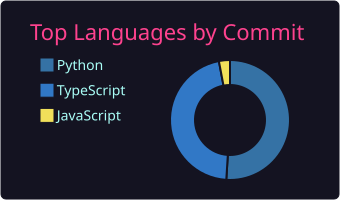

**Building full-stack, security-conscious SaaS platforms — from multi-tenant architectures to encrypted content delivery.**

I'm a Software Engineer who builds multi-tenant web applications for production use, with a focus on **backend performance and security**.

- 🏗️ Develop full-stack web applications: responsive user interfaces, RESTful APIs and server-side business logic
- 🔐 Build secure authentication, role-based access control (RBAC), payment gateway integration and multi-tenant data isolation
- ⚡ Hands-on with query optimization, indexing, caching and load testing to keep applications fast as they scale
- 🗄️ Work across relational and NoSQL databases

**Languages**

**Frontend**

**Backend**

**Databases**

**Tools & DevOps**

**Core Concepts**

### 🐍 Contribution Snake

<picture>
  <source media="(prefers-color-scheme: dark)" srcset="https://raw.githubusercontent.com/sachin-iam/sachin-iam/output/github-contribution-grid-snake-dark.svg" />
  <source media="(prefers-color-scheme: light)" srcset="https://raw.githubusercontent.com/sachin-iam/sachin-iam/output/github-contribution-grid-snake.svg" />
  
</picture>

  
  

  
  

  
  

  

**More details on my portfolio →** [sachin.bakechain.in](https://sachin.bakechain.in)

