


Building full-stack, security-conscious SaaS platforms — from multi-tenant architectures to encrypted content delivery.

I'm a Software Engineer who builds multi-tenant web applications for production use, with a focus on **backend performance and security**.

- Develop full-stack web applications: responsive user interfaces, RESTful APIs and server-side business logic
- Build secure authentication, role-based access control (RBAC), payment gateway integration and multi-tenant data isolation
- Hands-on with query optimization, indexing, caching and load testing to keep applications fast as they scale
- Work across relational and NoSQL databases


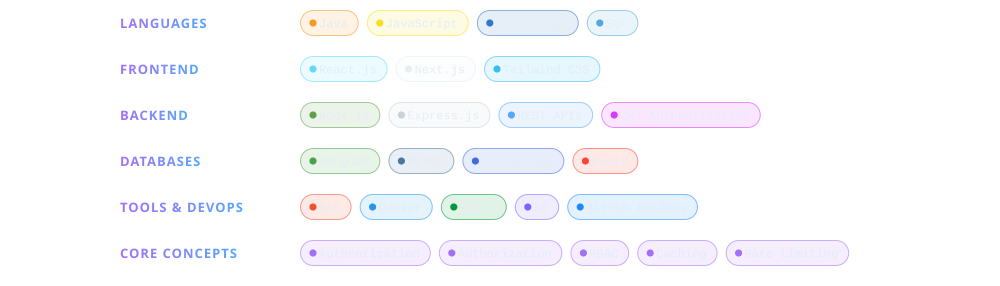


  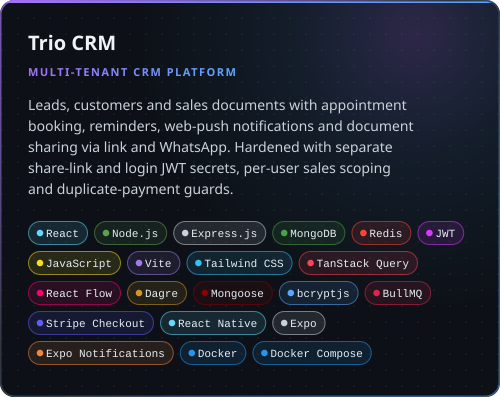
  

+15 more · Trio CRM

 
<code>JavaScript</code> <code>Vite</code> <code>Tailwind CSS</code> <code>TanStack Query</code> <code>React Flow</code> <code>Dagre</code> <code>Mongoose</code> <code>bcryptjs</code> <code>BullMQ</code> <code>Stripe Checkout</code> <code>React Native</code> <code>Expo</code> <code>Expo Notifications</code> <code>Docker</code> <code>Docker Compose</code>

+14 more · Multi-Tenant Learning Platform

 
<code>Vite</code> <code>Tailwind CSS</code> <code>Spring Security</code> <code>JPA</code> <code>Flyway</code> <code>Agora Cloud Recording</code> <code>OvenMediaEngine</code> <code>WebSocket / STOMP</code> <code>FFmpeg</code> <code>HLS</code> <code>MinIO</code> <code>ShedLock</code> <code>Docker Compose</code> <code>Bash</code>

  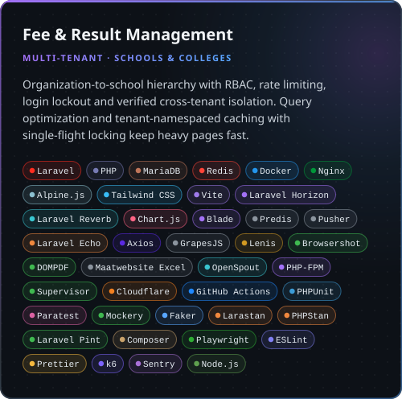
  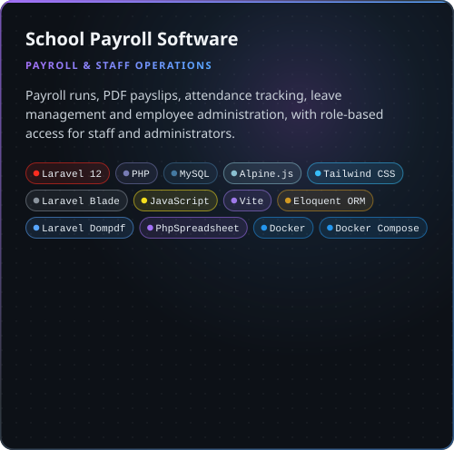

+35 more · Fee &amp; Result Management

 
<code>Alpine.js</code> <code>Tailwind CSS</code> <code>Vite</code> <code>Laravel Horizon</code> <code>Laravel Reverb</code> <code>Chart.js</code> <code>Blade</code> <code>Predis</code> <code>Pusher</code> <code>Laravel Echo</code> <code>Axios</code> <code>GrapesJS</code> <code>Lenis</code> <code>Browsershot</code> <code>DOMPDF</code> <code>Maatwebsite Excel</code> <code>OpenSpout</code> <code>PHP-FPM</code> <code>Supervisor</code> <code>Cloudflare</code> <code>GitHub Actions</code> <code>PHPUnit</code> <code>Paratest</code> <code>Mockery</code> <code>Faker</code> <code>Larastan</code> <code>PHPStan</code> <code>Laravel Pint</code> <code>Composer</code> <code>Playwright</code> <code>ESLint</code> <code>Prettier</code> <code>k6</code> <code>Sentry</code> <code>Node.js</code>

+8 more · School Payroll Software

 
<code>Laravel Blade</code> <code>JavaScript</code> <code>Vite</code> <code>Eloquent ORM</code> <code>Laravel Dompdf</code> <code>PhpSpreadsheet</code> <code>Docker</code> <code>Docker Compose</code>

  
  

+12 more · Question Paper Generator

 
<code>Laravel Blade</code> <code>JavaScript</code> <code>Vite</code> <code>Jodit</code> <code>Eloquent ORM</code> <code>Spatie Laravel Permission</code> <code>Dompdf</code> <code>PhpSpreadsheet</code> <code>PhpWord</code> <code>Docker</code> <code>Docker Compose</code> <code>Apache</code>

+14 more · Poetry Store

 
<code>React</code> <code>Tailwind CSS</code> <code>Framer Motion</code> <code>dnd-kit</code> <code>Recharts</code> <code>Node.js</code> <code>JavaScript</code> <code>Mongoose</code> <code>JWT</code> <code>bcryptjs</code> <code>Multer</code> <code>Nodemailer</code> <code>Docker</code> <code>Nginx</code>

  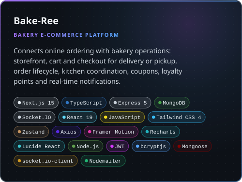

+15 more · Bake-Ree

 
<code>Socket.IO</code> <code>React 19</code> <code>JavaScript</code> <code>Tailwind CSS 4</code> <code>Zustand</code> <code>Axios</code> <code>Framer Motion</code> <code>Recharts</code> <code>Lucide React</code> <code>Node.js</code> <code>JWT</code> <code>bcryptjs</code> <code>Mongoose</code> <code>socket.io-client</code> <code>Nodemailer</code>

More details on my portfolio → <a href="https://sachin.bakechain.in">sachin.bakechain.in</a>


<picture>
  <source media="(prefers-color-scheme: dark)" srcset="https://raw.githubusercontent.com/sachin-iam/sachin-iam/output/github-contribution-grid-snake-dark.svg" />
  <source media="(prefers-color-scheme: light)" srcset="https://raw.githubusercontent.com/sachin-iam/sachin-iam/output/github-contribution-grid-snake.svg" />
  
</picture>

